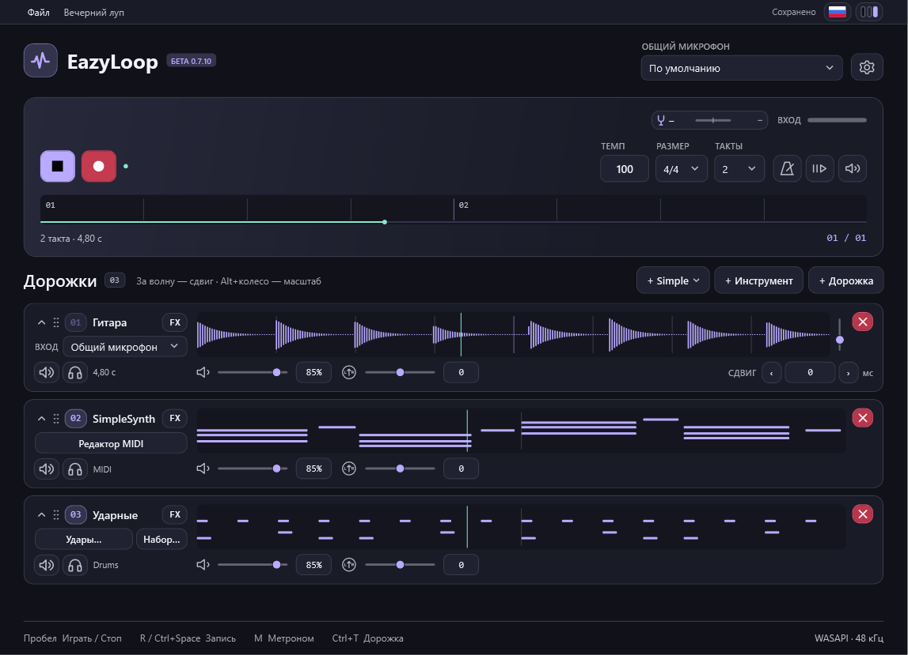
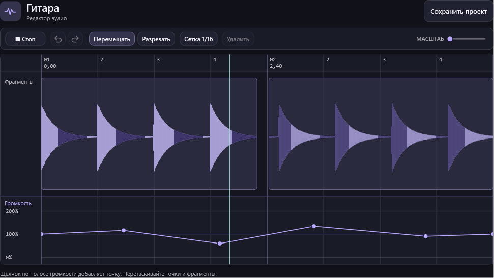
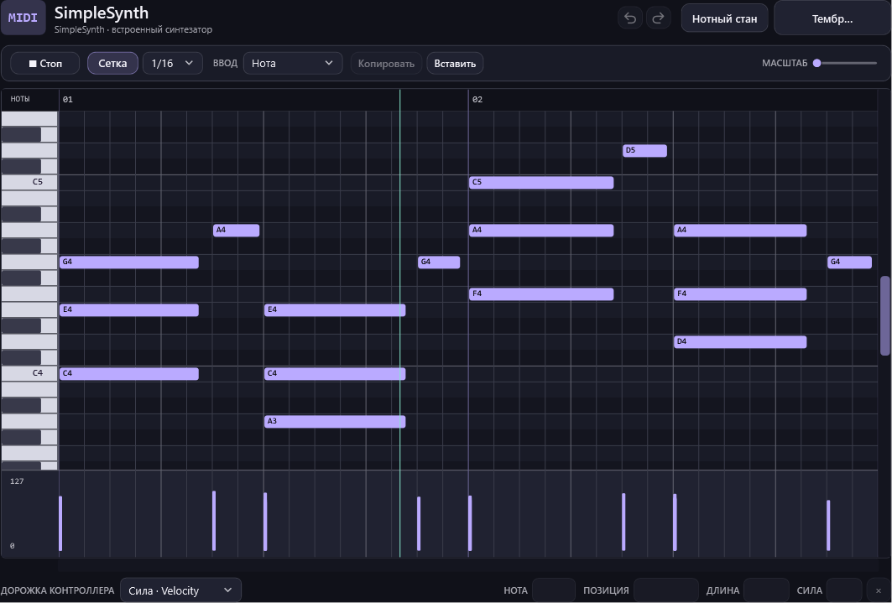

# EazyLoop

EazyLoop — мини-секвенсор для быстрого создания лупов из гитары, голоса и MIDI. Запиши слой с микрофона, добавь партии и сохрани всё в одной папке проекта.

[Скачать портативную бету для Windows x64](https://github.com/Ardn1/EazyLoop/releases/tag/v0.7.10) · [Руководство](docs/guide-ru.md) · [MIT](LICENSE)

## Возможности

- **Запись лупов** с выбором микрофона и входа для каждой дорожки, темпом, метрономом и предтактом.
- **Редактор аудио** для разрезания, сдвига фрагментов и настройки громкости по точкам. Исходная запись хранится в проекте.
- **MIDI и встроенные инструменты** с piano roll, нотным станом, редактором ударных, SimpleSynth, SimpleDrums и глиссандо-синтом.
- **Микшер и эффекты** с громкостью, панорамой, мьютом, соло, эквалайзером, автотюном, шумодавом RNNoise и поддержкой VST3.
- **Сохранение проектов и экспорт WAV**, а также темы и пять языков интерфейса.

## Быстрый старт

Распакуй архив и запусти <code>EazyLoop.exe</code>. Установка и отдельный .NET Runtime не требуются. Выбери микрофон, нажми **R** или **Ctrl+Space** для записи, затем добавляй слои. Щелчок по записанной волне открывает редактор, **Ctrl+S** сохраняет проект.

Редакторы аудио и MIDI

## Структура проекта

| Папка | Содержимое |
| --- | --- |
| `src/Shell`, `src/Tracks` | Главное окно, транспорт и карточки дорожек |
| `src/Audio`, `src/Effects` | Аудиодвижок, редактор записи, анализ сигнала и эффекты |
| `src/Midi` | MIDI-дорожки, piano roll, ударные, глиссандо и синтезатор |
| `src/Projects`, `src/Infrastructure` | Хранение проектов, локализация и история правок |
| `src/Themes`, `assets`, `Languages` | Темы, значок приложения и переводы |
| `scripts`, `docs`, `ThirdParty` | Выпуск сборок, руководство и сторонние компоненты |

## Сборка

Windows x64, .NET 10 SDK и WPF. Для проверки исходников выполните `dotnet build EazyLoop.csproj`. Для выпуска портативной сборки выполните из основного рабочего дерева:

    .\scripts\Publish-Local.ps1

Скрипт назначает следующий номер и сохраняет сборку в `dist\<версия>`. Параметр `-UpdateDesktopShortcut` также обновляет ярлык EazyLoop. Порядок работы из нескольких чатов описан в [AGENTS.md](AGENTS.md).

## Лицензии

Исходный код EazyLoop доступен по [MIT](LICENSE). [NAudio](NAudio-LICENSE.txt) распространяется по MIT, [RNNoise](ThirdParty/RNNoise/RNNoise-LICENSE.txt) — по BSD 3-Clause. Внешние VST3 подключаются отдельно.
